# RS-RL: Reinforcement-Learning Stress Testing with a Portfolio-Aware Scenario Recommender


Classic stress tests apply a handful of hand-written shocks ("what if the market falls 20%?"). Those scenarios are easy
to explain, but they only cover the failure modes someone thought of in advance.

This project lets reinforcement-learning agents **search** for 5-day market-shock paths that

1. **breach** a portfolio's risk limits, and
2. stay **plausible**: no more extreme than the most extreme 1% of real 5-day market windows from 2015–2021.

The paths the agents find are de-duplicated into a validated **scenario library**. A **portfolio-aware recommender**
then picks a short, diverse shortlist with an explanation for each pick. A frozen version of the whole pipeline was
tested once on held-out 2024–2025 data.

**Authors:** [Yuval Shah](https://github.com/yuvalshah) · Vedant Pandey · Riddhima Shah · Tushar Varshney

---

## Contents

- [Headline results](#headline-results)
- [Pipeline](#pipeline)
- [Data and setup](#data-and-setup)
- [Risk engine](#risk-engine)
- [Shock model and plausibility](#shock-model-and-plausibility)
- [Stress testing as an MDP](#stress-testing-as-an-mdp)
- [Deep RL: PPO](#deep-rl-ppo)
- [Tabular RL: Q-learning and benchmarks](#tabular-rl-q-learning-and-benchmarks)
- [Scenario library](#scenario-library)
- [Recommender system](#recommender-system)
- [Evaluation on real market data](#evaluation-on-real-market-data)
- [Limitations](#limitations)
- [Repository layout](#repository-layout)
- [Getting started](#getting-started)

---

## Headline results

| Method (validation episodes, q = 0.01) | Valid, plausible breaches |
|---|---|
| Random actions | 0% (47% breach, none plausible) |
| Continuous Monte Carlo, 6,000 paths | 0 valid of 2,027 breaches |
| PPO (continuous actions) | 14.8% ± 12.1% |
| Scripted decline (−0.15 on every factor, every day) | 88.5% |
| Tabular Q-learning, β = 0 | 100%, median plausibility rank 0.021 |
| **Tabular Q-learning, β = 5 (plausibility-margin bonus)** | **99.9%, median plausibility rank 0.042** |

<p align="center">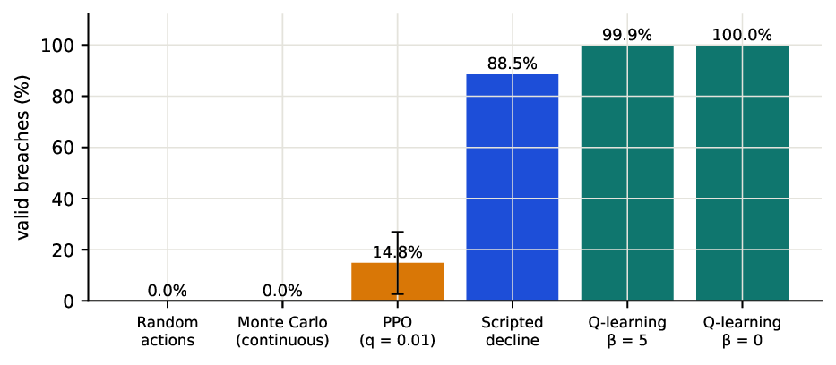</p>

- **PPO gets stuck.** At q = 0.01 it settles on single-day crashes that break the limit but are implausible, and
  neither an entropy bonus nor implausibility penalties get it out. At q = 0.005 the same agent reaches 98.7%.
- **Tabular Q-learning solves the discretised problem.** On 9 grouped actions and 120 states it matches a
  dynamic-programming benchmark. The β bonus doubles how plausible its breaches are, at a cost of 0.1 percentage
  points of reliability.
- **Reacting to noise helps.** The adaptive Q-policy is valid 99.9–100% of the time. Its own paths replayed open-loop
  reach only 77–88%.
- **Final test, 2024–2025, run once.** Frozen PPO reached 22.8% valid breaches, against 25.5% on validation. The only
  real limit breach in the test period (April 2025) was judged plausible, and the library contains a close match for
  it.

---

## Pipeline

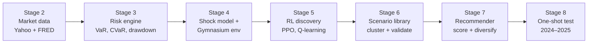

| Stage | Notebook | What it does |
|---|---|---|
| 1 | [`stage_1.ipynb`](stage_1.ipynb) | Configuration and the portfolio (8 US stocks, equal weight, USD 100k) |
| 2 | [`stage_2.ipynb`](stage_2.ipynb) | Data download, cleaning, features, chronological splits |
| 3 | [`stage_3.ipynb`](stage_3.ipynb) | Risk engine: VaR / CVaR, drawdown, Euler contributions, limits, historical stress |
| 4 | [`stage_4.ipynb`](stage_4.ipynb) | Factor + Student-t shock model, plausibility scoring, `StressTestEnv` |
| 5 | [`stage_5.ipynb`](stage_5.ipynb) | Scenario discovery: Monte Carlo, Q-learning, Double Q, 5-step, DP, enumeration |
| 6 | [`stage_6.ipynb`](stage_6.ipynb) | Validated scenario library: families, clustering, robustness, vulnerability |
| 7 | [`stage_7.ipynb`](stage_7.ipynb) | Recommender: eligibility, multi-criteria score, diversity re-ranking, explanations |
| 7.2 | [`stage_7_2_unseen_evaluation.ipynb`](stage_7_2_unseen_evaluation.ipynb) | 195-scenario catalog, real-data evaluation, 2000–2014 backcast |
| 8 | [`stage_8_final_test.ipynb`](stage_8_final_test.ipynb) | Frozen pipeline evaluated once on 2024–2025 |

Every notebook is committed with its recorded outputs and charts, and each ends with an automated check table. All
checks pass (for example Stage 5 19/19, Stage 6 16/16, Stage 7 18/18, Stage 8 12/12).

---

## Data and setup

| Item | Value |
|---|---|
| Portfolio | AAPL, MSFT, NVDA, JPM, XOM, JNJ, WMT, CAT at 12.5% each; USD 100,000; long-only; rebalanced daily |
| Market factors | SPY (market), QQQ (technology), XLF (financials), XLE (energy); VIX for market state |
| Data | Yahoo Finance and FRED, 2015-01-02 to 2025-12-31 (2,766 trading days) |
| Splits | **train** 2015–2021 (fitting, training) · **validation** 2022–2023 (selection, reporting) · **test** 2024–2025 (used once) |
| Risk limits | 5-day loss ≥ 10%, 5-day drawdown ≥ 10% (the binding one), 1-day VaR₉₅ ≥ 3%, CVaR₉₅ ≥ 6% |
| Plausibility | A path is valid if its historical rank ρ ≥ q = 0.01 |

No price is ever filled, extreme moves are flagged rather than removed, and everything that is fitted (the model,
standardisation, calibration) uses the training split only.

<p align="center">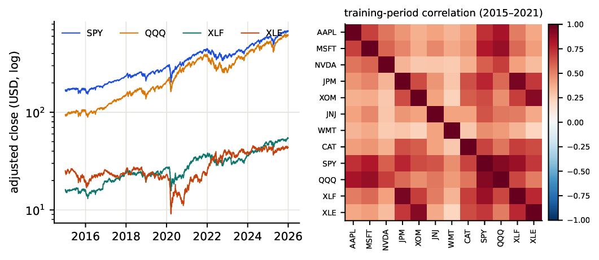</p>

SPY and QQQ are 0.92 correlated in training, JPM tracks XLF (0.95) and XOM tracks XLE (0.91). That collinearity
shapes both the factor model and the grouped RL actions.

---

## Risk engine

The risk engine is the scorer that the RL environment uses to decide whether a path breaches a limit, so historical
analysis and simulation share exactly the same formulas.

$$\mathrm{VaR}_\alpha=-r_{(\lceil np\rceil)},\qquad \mathrm{CVaR}_\alpha=-\frac{1}{m}\Big(\sum_{i=1}^{j}r_{(i)}+(m-j)\,r_{(j+1)}\Big),\quad m=np,\ j=\lfloor m\rfloor$$

$$\mathrm{MDD}=\min_t\Big(\frac{V_t}{\max_{s\le t}V_s}-1\Big),\qquad \mathrm{RC}_i=w_i\frac{(\Sigma w)_i}{\sqrt{w^\top\Sigma w}}$$

| Training period | Value |
|---|---|
| Annual volatility | 20.12% |
| 1-day VaR₉₅ / CVaR₉₅ | 1.86% / 3.06% |
| 1-day VaR₉₉ / CVaR₉₉ | 3.68% / 5.16% |
| Max drawdown | −30.63% (2020-02-19 → 2020-03-23) |
| Largest volatility contributor | NVDA, 20.3% of portfolio volatility |

<p align="center">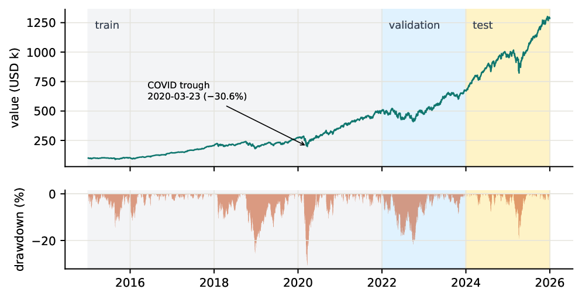</p>
<p align="center">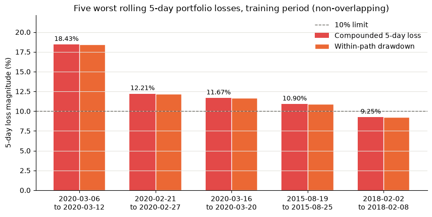</p>

Four of the five worst training weeks break the 10% limit. Replaying the COVID week of 9–13 March 2020 gives an 8.14%
loss but a 16.76% drawdown, so real crashes break the drawdown limit before the loss limit.

---

## Shock model and plausibility

**Simulator.** Sector factors are first regressed on SPY to remove collinearity (VIFs fall from 29.0 to at most 1.97).
Each stock is then modelled as

$$r_{i,t}=a_i+b_i^\top f_t+\varepsilon_{i,t},\qquad (f_t,\varepsilon_t)\sim t_{\nu=4.5}(\mu,\Sigma)$$

with one joint Student-t fitted by EM, so stock-specific noise widens on extreme market days. Simulated portfolio
VaR₉₅ is 1.77%, against 1.86% in the data.

<p align="center">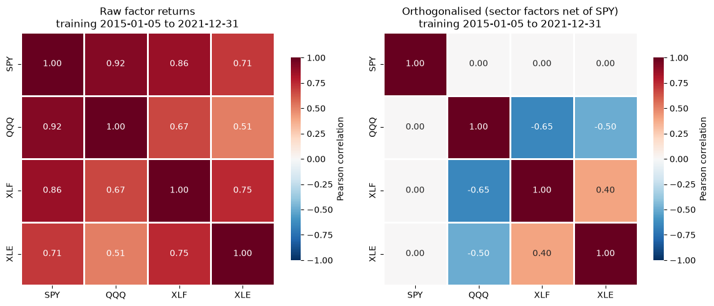</p>

**Plausibility of a day.** A separate factor-only t (ν = 3.5) gives each day a tail probability and a surprisal:

$$\delta=(f-\mu_f)^\top\Sigma_f^{-1}(f-\mu_f),\qquad p=P\big(F_{k,\nu_f}\ge\delta/k\big),\qquad s=-\ln p$$

A coherent fall (SPY −5%, QQQ −6%, XLF −5%, XLE −5%) has p = 0.015. The same size with QQQ up 5% has
p = 4.6·10⁻⁵, because markets rarely split like that.

**Plausibility of a path.** Real returns cluster in volatility, so independent-day probabilities are not calibrated
to real weeks. The **historical rank** ρ of a path is therefore the share of the 1,758 real training 5-day windows
that are at least as extreme. A path is plausible if ρ ≥ 0.01.

<p align="center">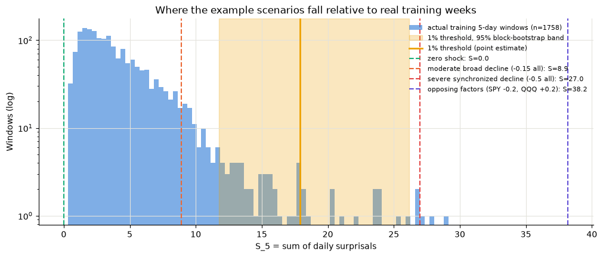</p>

---

## Stress testing as an MDP

| Element | Definition |
|---|---|
| Episode | 5 trading days from a real anchor date (train anchors for training, validation anchors for evaluation) |
| Observation (26) | Days left; factor and stock cumulative returns; loss and drawdown; surprisal, tail probability, rank; VIX and SPY volatility at the anchor |
| Action | `a ∈ [−1, 1]⁴`; one unit = 12 model s.d. (SPY ±12.67%, QQQ ±15.96%, XLF ±16.92%, XLE ±23.36%) |
| Transition | Factor shock → stock returns with conditional Student-t noise → portfolio revalued by the risk engine |
| Termination | Limit breach (valid or implausible) or day 5; γ = 0.99 |

$$R_t = \underbrace{10\,\mathbb 1[\text{valid breach}]}_{\text{goal}} + \underbrace{5\,\Delta\mathrm{DD}_t}_{\text{severity}} - \underbrace{0.2\min(s_t,25)}_{\text{plausibility}} - \underbrace{0.5\,\overline{a_t^2}}_{\text{magnitude}} - \underbrace{0.01}_{\text{step}}$$

The +10 is paid once, and only if the path is still plausible at the breach. An implausible breach ends the episode
with nothing. `reset(seed)` fixes both the anchor and the noise, so every policy is compared on identical episodes.

<p align="center">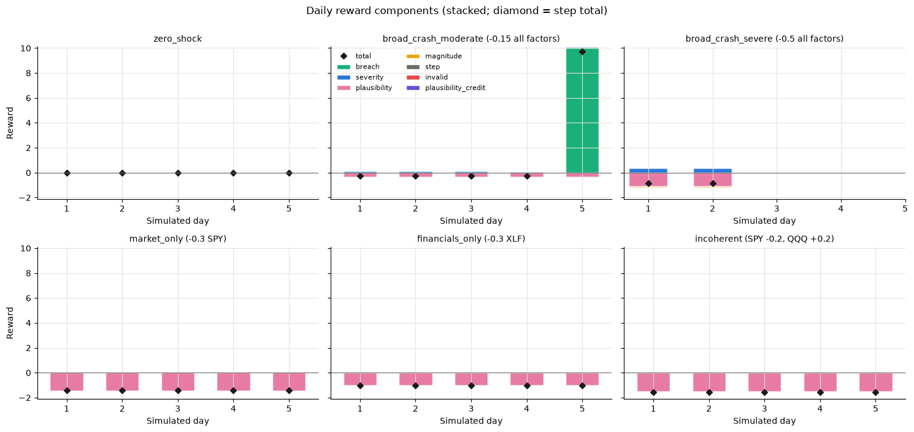</p>

Six scripted episodes check the environment before any learning. Only the coherent moderate decline (11.03% loss,
rank 0.081) earns the breach reward. The severe decline breaches on day 2 but is implausible and earns nothing.

---

## Deep RL: PPO

Stable-Baselines3 PPO with an MLP of 2 × 64, 100k steps per run, 3 thresholds × 3 seeds, learning rate 3e-4,
n_steps 1024, batch 64, 10 epochs, GAE λ 0.95, clip 0.2, initial log σ −1 and normalised observations. Checkpoints
are selected on validation seeds 10000–10199 and reported on separate seeds.

| Policy | q = 0.005 | q = 0.01 | q = 0.02 |
|---|---|---|---|
| Scripted decline | 88.5% | 88.5% | 88.5% |
| **PPO** | **98.7% ± 1.1** | 14.8% ± 12.1 | 0.0% |
| PPO + entropy 0.01 | – | 9.5% ± 11.8 | – |
| PPO + implausible-breach penalty κ = 5 / 10 | – | 0.0% / 0.0% | – |

**Why it fails at q = 0.01.** Within about 20k steps almost every episode ends in one COVID-like crash day. That path
earns about −1.1, better than noisy no-breach episodes at about −3.2, and the policy stops exploring (σ falls from 0.37
to about 0.05). Better returns exist under the same reward (the scripted decline earns +7.5), but the all-or-nothing
breach reward gives no gradient between an implausible crash and a valid one. Penalising implausible breaches removed
the trap, and PPO then learned to do almost nothing.

---

## Tabular RL: Q-learning and benchmarks

The problem is shrunk until it can be explored exhaustively:

- **9 actions**: (SPY, QQQ) and (XLF, XLE) each move by one of {−0.30, −0.15, 0}.
- **120 states**: day (5) × drawdown bin (6) × plausibility-rank bin (4).
- **Update**: `Q(s,a) ← Q(s,a) + α[r + γ max Q(s',a') − Q(s,a)]` with `α = max(0.05, 1/n)`, ε-greedy from 1 to 0.05
  plus a visit bonus, 20,000 episodes × 3 seeds.
- **Plausibility-margin bonus** on valid breaches, with β = 5 fixed before the run:

$$\beta\,m,\qquad m=\mathrm{clip}\Big(\frac{\ln(\rho/q)}{\ln(1/q)},\,0,\,1\Big)$$

| Method (β = 5 unless stated) | Adaptive policy: valid | Median rank | Open-loop replay: valid |
|---|---|---|---|
| Q-learning, β = 0 | 100.0% | 0.021 | 82.8% |
| **Q-learning, β = 5** | **99.9%** | **0.042** | 82.5% |
| Double Q-learning | 100.0% | 0.035 | 87.6% |
| 5-step (Monte Carlo) targets | 100.0% | 0.042 | 77.5% |
| Dynamic programming (β = 0 / 5) | 100.0% / 100.0% | 0.020 / 0.040 | 88.2% / 87.2% |
| Exhaustive enumeration of all 9⁵ = 59,049 sequences | – | best valid rank 0.0859 | – |

<p align="center">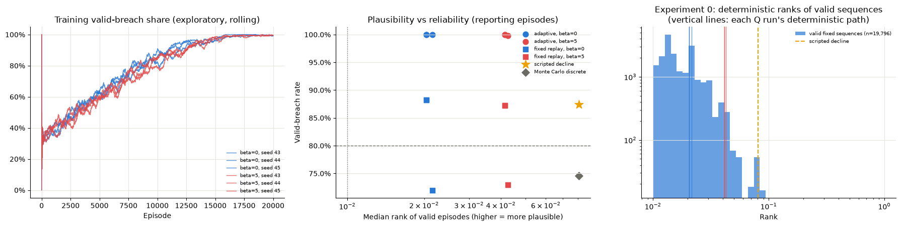</p>
<p align="center">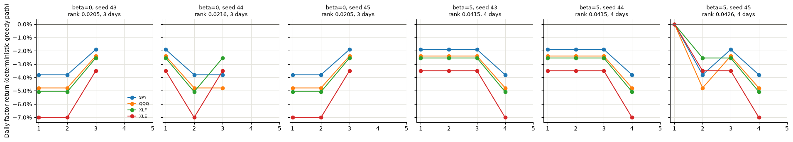</p>

With β = 0 the agents learn a 3-day crash at rank about 0.021. With β = 5 they spread it over 4 days and reach about
0.042, roughly twice as plausible. Q-learning matches the DP optimum of the same discretised MDP. The cost of grouping
the factors is coverage: technology-, financial- or energy-only shocks cannot be expressed.

---

## Scenario library

```
8,961 candidate paths  →  566 unique valid breaches  →  16 clusters  →  8 validated scenarios
```

- **Families**: broad-market, technology-, financial- or energy-led, sector-led, mixed-direction.
- **Clustering**: average linkage on the cumulative shock path, cut at 0.671 = 2 × 0.15√5 (about two action steps).
- **Robustness**: each scenario is replayed on 200 screening episodes (used for selection) and 500 separate reporting
  episodes, with Wilson 95% intervals. It is validated if ρ ≥ 0.01 and screening P(valid) ≥ 80%.
- **Vulnerability**: each path's P&L is split exactly by holding and approximately by factor, and these numbers feed
  the recommender's explanations.

<p align="center">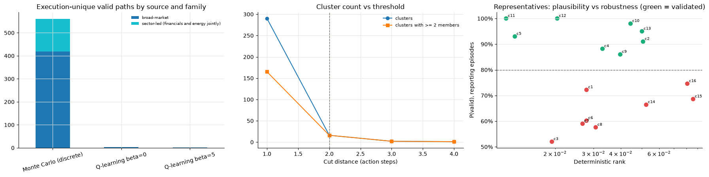</p>
<p align="center">
  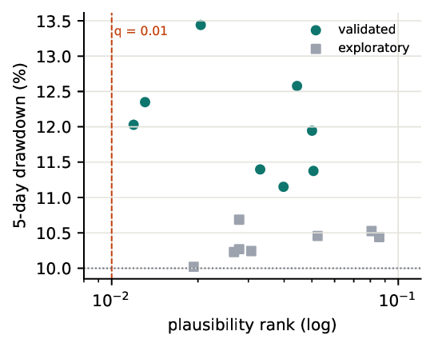
  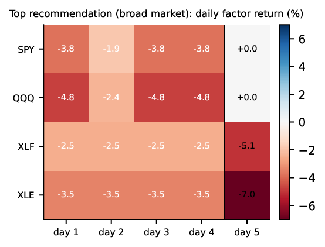
</p>

---

## Recommender system

The **user** is a portfolio (weights, factor loadings and loss direction) and the **items** are validated
scenarios. With no interaction data, the recommender is context-aware, content-based and multi-criteria:

1. **Eligibility**: validated, ρ ≥ 0.01, screening P(valid) ≥ 80%, at least 100 reporting episodes, P(implausible) ≤ 5%.
2. **Score**, with equal weights:

$$S(u,i)=\tfrac14\Big[\tfrac{1+\cos(x_i,d_u)}{2}+\tfrac{\mathrm{DD}_{u,i}-\min\mathrm{DD}}{\max\mathrm{DD}-\min\mathrm{DD}}+\tfrac{\ln(\rho_i/q)}{\ln(1/q)}+\mathrm{Wilson}_{\text{low}}(P_i)\Big]$$

3. **Diversity re-ranking** (MMR-style): pick greedily by `S − 0.5 · max exp(−d/0.671)`, k = 5.
4. **Explanation** for each pick: the leading factor shock, the replayed drawdown, the worst holdings and the intervals.

| Default portfolio, 8 eligible | Mean score | Independent P(valid) | Mean similarity |
|---|---|---|---|
| Highest score | 0.672 | 98.2% | 0.268 |
| **Diversity-aware** | 0.663 | 96.5% | **0.187** |
| Random (1,000 seeds) | 0.626 | 95.5% | 0.225 |

<p align="center">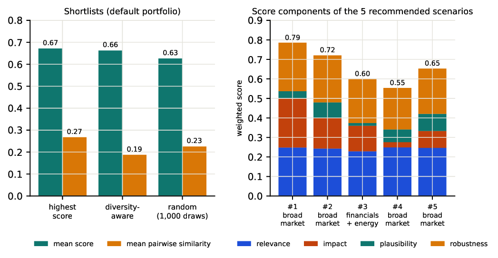</p>

The diversity-aware list gives up 1.4% of mean score for 30% less redundancy. When the catalog grows from 8 to 195
eligible scenarios, personalisation across 54 portfolios rises from 0.42 to 0.91, with simulated P(valid) of 99.0%.

<p align="center">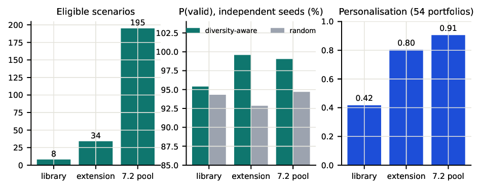</p>

---

## Evaluation on real market data

The final test ran the frozen Stage 4–7 pipeline **once** on 2024–2025, after checksums of every artifact were
verified. Three kinds of evidence are kept apart:

| Evidence | Finding |
|---|---|
| **Historical** (real returns) | Factor-model R² fell from 0.55 to 0.37, and VaR₉₅ was too conservative for a calm period (2.4% exceedances, Kupiec p = 0.003). One real breach in the week of 2025-04-03 (12.6% drawdown) was judged plausible (rank 0.0131) and is matched by library scenario S6-3b5f9089. |
| **Policy** (frozen PPO) | 22.8% [19.3%, 26.7%] valid, against 25.5% on validation: no significant change. |
| **Simulation** (frozen scenarios) | Shortlist P(valid) unchanged within noise: highest score 98.1%, diversity-aware 95.8%. |

<p align="center">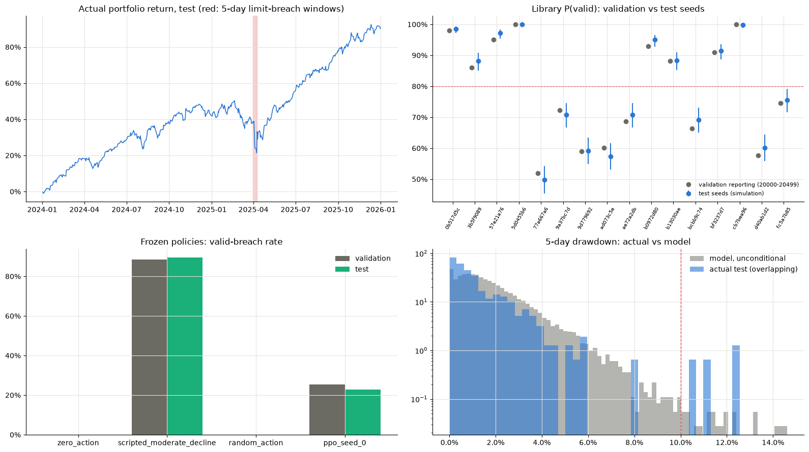</p>

A backcast on never-used 2000–2014 data (651 portfolio-level breach weeks) shows that the recommended scenarios match
the direction of real crashes (Hit@5 0.92). Random picks from the same pool do about as well (0.90), because nearly
every scenario is an "everything falls" path.

<p align="center">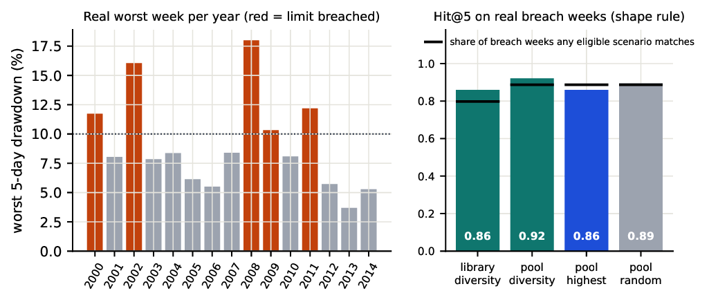</p>

---

## Limitations

- Daily shocks are i.i.d. and the dynamics ignore the market state. At 99% the simulated tails are about 15% lighter
  than history.
- Plausibility is calibrated on 2015–2021, whose most extreme weeks all fall in March–April 2020.
- The grouped actions cannot produce sector-only or mixed-direction scenarios.
- The Q-learning tables were not saved, so only PPO could be re-tested out of sample.
- The recommender does not yet pick real-crash-like scenarios better than chance on the backcast.

---

## Repository layout

```
src/rlstress/
  data/                    download, cleaning, alignment, features, splits
  portfolio/ risk/ stress/ valuation, VaR/CVaR, drawdown, contributions, limits, historical stress
  shocks/                  factor model, multivariate Student-t, plausibility, simulator
  env.py                   Gymnasium StressTestEnv
  rl/                      PPO training, evaluation, calibration, policies
  search.py                Monte Carlo, tabular Q-learning, Double Q, n-step, DP, enumeration
  scenario_library.py      families, clustering, robustness, library schema
  scenario_recommender.py  eligibility, scoring, diversity re-ranking, explanations
  unseen_evaluation.py     real-data relevance labels, Hit@k / Recall@k, block bootstrap
  final_evaluation.py      Newcombe intervals, Kupiec test, overlapping windows
tests/                     421 offline tests, including a layered-architecture check
config/default.toml        every parameter: portfolio, limits, simulation, training, splits, seeds
examples/                  command-line demos and PPO train / evaluate scripts
stage_*.ipynb              the stage notebooks with recorded outputs
assets/                    figures used in this README
```

---

## Getting started

```bash
git clone https://github.com/yuvalshah/RS-RL.git && cd RS-RL
python -m venv .venv && source .venv/bin/activate
pip install -e ".[dev,rl]"

pytest                      # 421 offline tests; no data or API key needed

cp .env.example .env        # add a free FRED API key (only Stage 2 macro data needs it)
jupyter notebook stage_2.ipynb
```

Stage 2 downloads and processes the data into `data/`, and each later notebook writes its outputs to `results/`.
Neither folder is committed. Long runs were executed single-threaded
(`OMP_NUM_THREADS=1 nice -n 15`).

*Research prototype for a university course. It is not investment advice or a production risk system.*
